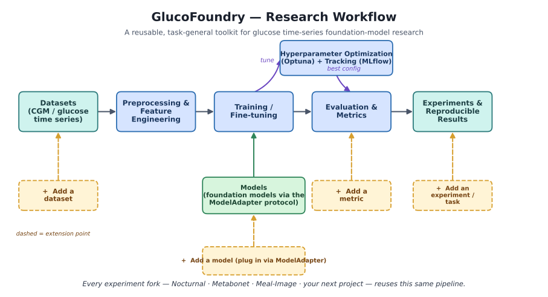
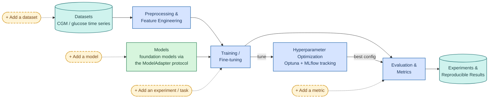

# GlucoFoundry — Research Workflow (at a glance)

This is a high-level, general-audience view of how the GlucoFoundry toolkit works
and how it is designed to be **extended**. Every experiment fork — Nocturnal,
Metabonet, the new Meal-Image project, and any future project — reuses this same
pipeline.



> The diagram above is a scalable vector (`glucofoundry_workflow.svg`). A raster
> copy (`glucofoundry_workflow.png`) is also provided for contexts that cannot
> display SVG.

## The workflow in one line

**Datasets → Preprocessing & Features → Training → Evaluation → Reproducible
Results**, with **Models** plugged into training and **Hyperparameter
Optimization (Optuna) + tracking (MLflow)** tuning the models along the way.



## Built to be extended

The dashed boxes are the toolkit's **extension points** — you add capability
without rewriting the pipeline:

- **Add a dataset** — point the loaders at a new data source.
- **Add a model** — plug any model in through the `ModelAdapter` protocol.
- **Add an experiment / task** — forecasting, classification, event detection,
  and more; the toolkit is task-general, not forecasting-only.
- **Add a metric** — register new evaluation criteria.

## Regenerating the image

The PNG/SVG are produced by a small matplotlib script (only dependency is
matplotlib):

```bash
python agent_notes/diagrams/render_glucofoundry_workflow.py
```

The Mermaid source (`glucofoundry_workflow.mmd`) is the same diagram in a form
that renders natively on GitHub and can be exported with `mmdc` if the Mermaid
CLI is installed.
